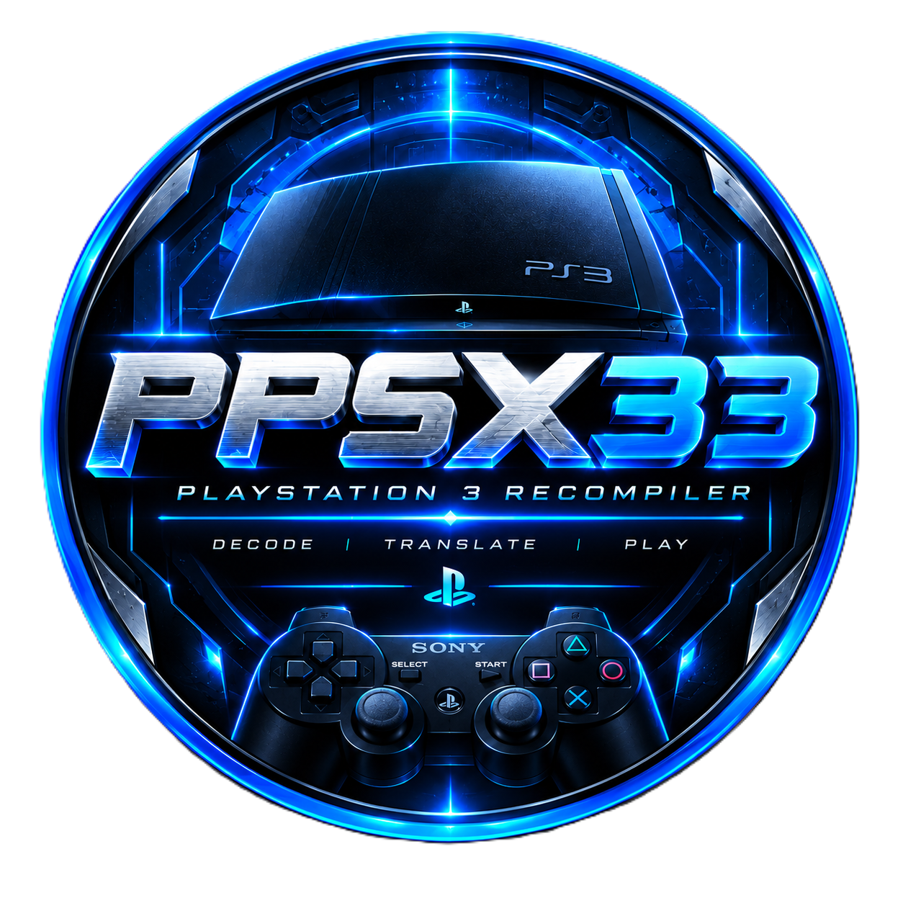
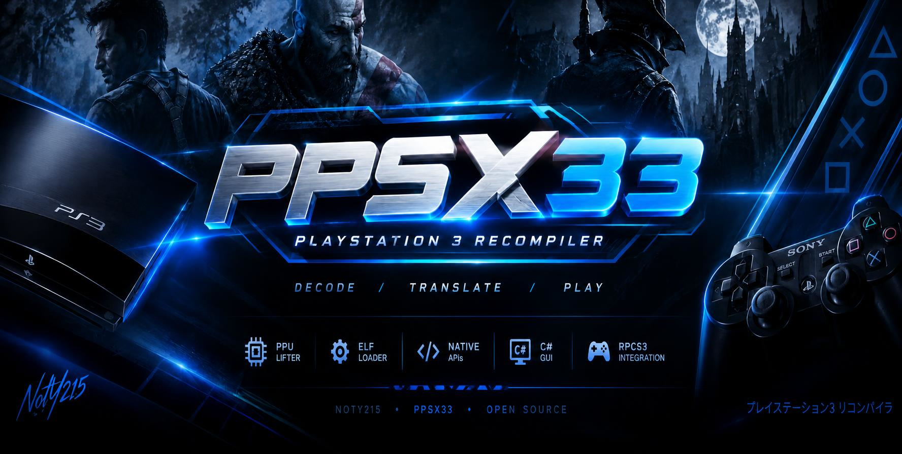

<!-- PPSX33 project identity -->
<p align="center">
  
</p>

<h1 align="center">PPSX33</h1>
<p align="center"><strong>PlayStation 3 Static Recompiler Research</strong></p>
<p align="center">From decrypted PowerPC64 code to a native Windows build, one subsystem at a time.</p>

<p align="center">
  
</p>

<p align="center">
  <a href="ROADMAP.md">🧭 Roadmap</a> ·
  <a href="docs/DEVELOPER_GUIDE.md">🛠️ Developer guide</a> ·
  <a href="USER_MANUAL.md">📘 User manual</a> ·
  <a href="docs/games/README.md">🎮 Game notes</a>
</p>

<p align="center">
  
  
  
</p>

> [!IMPORTANT]
> **PPSX33 is experimental software, not a finished PS3 compatibility solution.** A successful lift or build does not mean a game is playable. PPU semantics, HLE, SPU/DMA behaviour and real RSX rendering are still being developed and validated.

> [!NOTE]
> **Input format:** PPSX33 loads **decrypted ELF** files only. It does **not** decrypt EBOOTs, bundle keys, or launch external emulators. Obtaining a decrypted ELF is the user's responsibility (for example, offline tooling some users already have — not provided by this project).

## ✨ What PPSX33 is building

PPSX33 is an open-source research project exploring a different route from full-system emulation: **static recompilation**. It analyses a decrypted PS3 ELF, lifts supported PowerPC code into generated C++ and links that code against a host runtime intended to reproduce the PS3 services the title expects.

The aim is not to pretend the PS3 is simple. The aim is to make each part observable, testable and replaceable, from instruction semantics to graphics output.


### 🔁 The pipeline

<p align="center">
  <strong>Decrypted ELF</strong> &nbsp; → &nbsp;
  <strong>🧭 Analyse</strong> &nbsp; → &nbsp;
  <strong>⚙️ Lift to C++</strong> &nbsp; → &nbsp;
  <strong>🔗 Link runtime</strong> &nbsp; → &nbsp;
  <strong>🧪 Validate</strong>
</p>

1. **Load** a decrypted ELF or supported game layout that you are legally entitled to use.
2. **Analyse and lift** supported PPU instruction regions into generated C++.
3. **Resolve runtime dependencies** through the current LV2, PRX and library HLE layers.
4. **Build** a native Windows executable using the installed Microsoft C++ toolchain.
5. **Measure what actually works** using traces, lift reports and per-game test notes.

The last step matters: generated code is only one milestone. Correct execution and rendered gameplay must be demonstrated separately.

## 🚦 Implementation status

Status icons describe the current broad state, not a promise that every title or code path works.

| Area | Status | Current scope |
| --- | --- | --- |
| 🧰 GUI, project flow and build orchestration | 🟡 **Partial / evolving** | Windows GUI and native build pipeline; title-specific failures remain possible |
| 📦 ELF loading and PPU lifting | 🟡 **Partial** | Supported code can be lifted; translation coverage is not semantic correctness |
| 🧠 PPU runtime and control flow | 🟡 **In progress** | Guest context and execution paths exist; unsupported or inaccurate paths can break execution |
| 🪟 D3D11 host window and presentation | 🟢 **Implemented baseline** | Host graphics window/present path exists |
| 🧱 RSX/GCM command processing | 🟡 **In progress** | FIFO decode and D3D11 draws proven on boot-assist cmdstreams (`methods` / guest draw counts in logs); title-authored GCM and shaders still incomplete |
| 🧩 LV2, PRX and NID services | 🟡 **Partial** | HLE coverage is incomplete and individual API semantics require validation |
| ⚡ SPU, MFC/DMA and SPURS | 🟡 **Partial** | Assist/runtime paths exist; full instruction and scheduling behaviour is not complete |
| 🔊 Audio, 🎮 input and 💾 save services | 🟡 **Partial** | Basic host paths exist; title-level behaviour still needs verification |
| 🎯 End-to-end game compatibility | 🔴 **Not established generally** | Static lift reports do not establish bootability or playability |

**Legend:** 🟢 implemented baseline · 🟡 partial or under active development · 🔴 not established / major work remains


## 📚 Module status (HLE / runtime)

HLE and host services written for this project. Public emulator behaviour may be used as a **reference for expected results**, not as a code source. Counts are approximate; individual titles can still fail on “Complete” rows if a code path is wrong or incomplete.

| Category | Modules (scope) | Status |
| --- | --- | --- |
| Kernel threading | PPU thread / mutex / cond / semaphore HLE | 🟡 Partial |
| Kernel events / timers | Event queues, timer syscalls | 🟡 Partial |
| Kernel memory | sys_memory-style alloc, mmapper subset | 🟡 Partial |
| Filesystem | cellFs / path mapping, real host I/O | 🟡 Partial |
| Save data | cellSaveData / PARAM.SFO paths | 🟡 Partial |
| Input | cellPad mapping (XInput/host keys) | 🟡 Partial |
| Audio | cellAudio host path (waveOut-style) | 🟡 Partial |
| Video out / GCM | cellVideoOut, cellGcmSys control/FIFO kick | 🟡 Partial |
| Graphics (RSX) | FIFO decode, D3D11 present; assist draws proven; title stream pending | 🟡 In progress |
| SPU / MFC / SPURS | Interpreter, DMA/tags, job assist | 🟡 Partial |
| PRX / NID / LV2 | Import stubs, common syscalls | 🟡 Partial |
| Codecs / media | PNG/JPG helpers; ATRAC/VDEC deep decode | 🔨 Limited / partial |
| Network / NP | Not a product goal — stubs only if present | ⚪ Out of scope / stub |
| USB / Camera / Move | Not required for core recomp path | ⚪ Out of scope / stub |

**Legend:** 🟡 partial · 🔨 limited · ⚪ out of scope for current goals · 🟢 only when end-to-end proven on titles

Task-level tracking: [ROADMAP.md](ROADMAP.md).

For the task-level breakdown and longer-term architecture plan, see **[ROADMAP.md](ROADMAP.md)** and **[PPU coverage notes](docs/PPU_COVERAGE.md)**. Game-specific evidence and logs are collected under **[docs/games](docs/games/README.md)**.

## 🧩 Why this is difficult

The PS3 combines multiple processors and a custom graphics system. A useful recompiler has to reproduce the observable behaviour games depend on, not just translate their main CPU instructions.

| Component | Responsibility | Compatibility work |
| --- | --- | --- |
| **PPU** | 64-bit PowerPC main processor | Instruction semantics, branches, registers, memory and calling conventions |
| **SPU** | Synergistic processors | Vector operations, local store, channels and job execution |
| **MFC / DMA** | SPU data movement | Transfer ordering, tags, stalls and completion semantics |
| **RSX / GCM** | Graphics processor and command interface | FIFO, shaders, vertex data, textures, render targets and synchronization |
| **LV2 / PRX** | Kernel and modules | Threads, memory, events, imports, exports and module lifecycle |
| **cellFs and other libraries** | Game-facing system APIs | Correct paths, data formats, errors, timing and state |

A failure that looks like a graphics bug may actually be caused by a missing import or an SPU transfer that completed too early. Diagnostics should preserve that chain of evidence.

## 🏗️ Project layout

```text
PPSX33/
├── src/
│   ├── core/              # ELF handling, PPU lifter and build orchestration
│   ├── cli/               # Command-line tooling
│   └── gui/               # Windows GUI
├── runtime/               # Runtime linked with generated game builds
│   ├── ppu_runtime*.h     # Guest context and execution support
│   ├── ps3rt*.cpp / *.inl # HLE, imports and system services
│   ├── rsx_stub.cpp       # RSX/GCM-to-D3D11 work in progress
│   ├── spu_stub.cpp       # SPU and MFC support in progress
│   └── assets.cpp         # Asset and path helpers
├── assets/
│   ├── ppsx33-logo.png    # Project identity
│   ├── ppsx33-logo.ico    # Windows icon asset
│   └── ppsx33-banner.png  # README / project banner
├── docs/
│   ├── DEVELOPER_GUIDE.md
│   ├── PPU_COVERAGE.md
│   └── games/             # Per-title notes, reports and logs
├── redist/                # Toolchain setup guidance
├── ROADMAP.md
└── README.md
```

Generated projects may contain a game executable, `ps3rt.dll`, guest image data, generated source files, controller mapping and build logs. Exact output depends on the project and build path.

## 🖥️ Host support

| Item | Current target |
| --- | --- |
| Operating system | Windows x64 |
| Graphics backend | Direct3D 11; GPU feature support must be suitable for the build |
| Native compiler | Microsoft C++ toolchain |
| GUI framework | .NET 8 or the version specified by the project |
| Build tooling | CMake / Ninja for the relevant host targets |

Linux and macOS are **not supported host-runtime targets at present**. Requirements can change as the project evolves; check the build files and [redistributable/toolchain notes](redist/README.txt) before setting up a development machine.

## 🚀 Build and try the tools

1. Install Visual Studio with the C++ desktop development tools and a Windows SDK.
2. Install the .NET SDK required by the GUI project.
3. Clone this repository and open a terminal at the repository root.
4. Run the repository build helper:

   ```bat
   scripts\build_all.bat
   ```

5. Launch the generated GUI if the build completes successfully.
6. Load only a decrypted ELF or game layout you are legally entitled to use.
7. Review the lift report and build log before attempting to run the generated executable.

Build outputs and paths may vary by configuration. If a step fails, capture the complete error and toolchain version instead of assuming the project built successfully. The [developer guide](docs/DEVELOPER_GUIDE.md) and [user manual](USER_MANUAL.md) provide more detail.

## 🧪 How compatibility is evaluated

PPSX33 tracks different milestones separately:

- **Decode/lift coverage:** which instruction encodings the tool recognises or translates.
- **Semantic correctness:** whether translated instructions reproduce expected guest state.
- **Runtime service coverage:** whether required imports and system calls behave correctly.
- **Graphics correctness:** whether real game commands produce the expected image.
- **Game testing:** whether a documented path boots, accepts input and runs reliably.

A percentage in a lift report is not a compatibility rating. A title should only be described as playable when that claim is backed by reproducible end-to-end testing. See [PPU coverage](docs/PPU_COVERAGE.md) and the individual reports in [game documentation](docs/games/README.md).

## 🧭 Current engineering priorities

The most useful work is correctness-first:

1. Make unsupported PPU instructions fail visibly rather than silently becoming no-ops.
2. Trace invalid guest PCs and unresolved imports without guessing a recovery path.
3. Implement and test HLE APIs against their actual contracts.
4. Build a real RSX path incrementally: vertex input, shaders, textures, depth and render targets.
5. Validate SPU instructions, channels and DMA ordering with isolated tests.
6. Add regression tests and record the first successful real frame, audio output and input event.

The live task list is maintained in **[ROADMAP.md](ROADMAP.md)**. Contributions should include test evidence or a clear explanation of what remains unverified.

## 🕹️ Controller mapping

PPSX33 includes a controller mapping reference for the current input path:

The repository includes a controller-mapping reference in `assets/PPSX33 PS3 Controller Key Mapping.png`. Its asset provenance and any third-party marks/artwork should be verified before redistribution. See [KEY_MAPPING.md](docs/KEY_MAPPING.md) for the text reference.

See [KEY_MAPPING.md](docs/KEY_MAPPING.md) for the text reference. Actual game input support may depend on the title and runtime path.

## 🤝 Contributing

Useful contributions include:

- PPU instruction implementations with focused regression tests.
- Correct LV2/PRX behaviour backed by logs or API references.
- RSX command and shader work demonstrated with real test scenes.
- SPU and DMA tests that verify data and completion ordering.
- Reproducible Windows build fixes and clearer diagnostics.
- Game reports that distinguish “translated”, “boots”, “reaches menu” and “playable”.

Please keep changes scoped, explain assumptions, and do not add copyrighted game binaries, firmware or extracted game assets. Read [CONTRIBUTING.md](CONTRIBUTING.md) before opening a change.

## 🔗 Project references

- 🧭 [Roadmap](ROADMAP.md)
- 🛠️ [Developer guide](docs/DEVELOPER_GUIDE.md)
- 📘 [User manual](USER_MANUAL.md)
- 🧪 [PPU coverage report](docs/PPU_COVERAGE.md)
- 🎮 [Game notes and test logs](docs/games/README.md)
- ⌨️ [Controller key mapping](docs/KEY_MAPPING.md)
- 🧰 [Toolchain setup](redist/README.txt)
- 🛡️ [Security policy](SECURITY.md)
- 📜 [Legal notes](LEGAL.md)
- 🧾 [Third-party notices](THIRD_PARTY.md)

## ⚖️ Legal and preservation

PPSX33 does not bundle commercial game files, firmware, or proprietary keys. Its optional RPCS3 integration can invoke an external EBOOT decryption workflow; this does not establish permission to process a file or guarantee legality. Users must review applicable law and third-party terms. Asset provenance and license compatibility must be checked separately. See [LEGAL.md](LEGAL.md), [TERMS.md](TERMS.md) and [NOTICE](NOTICE).

## 📄 License

See [LICENSE](LICENSE) for the project's license. Third-party components, headers and SDKs remain subject to their own licenses.
