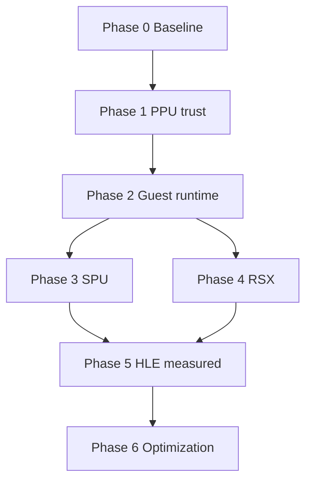

# PPSX33 Roadmap

**Website:** [https://ppsx33.xo.je/](https://ppsx33.xo.je/) · **Architecture:** [docs/ARCHITECTURE.md](docs/ARCHITECTURE.md) · **Diagrams:** [docs/DIAGRAMS.md](docs/DIAGRAMS.md)

Evidence-based status. External code audits are leads until proven by tests or title logs.

Legend: **Done** · **Partial** · **In progress** · **Blocked** · **Planned**

---

## Current critical path

| Priority | Work | Status |
| --- | --- | --- |
| 1 | PPU past sticky / import islands; recovery respects region bans | Partial |
| 2 | Null-loop / soft_breaks escape without inventing success | Partial |
| 3 | FIFO GET/PUT truth; GET only after accept | Partial |
| 4 | Guest PUT advances without boot assist | Blocked on HLE/boot |
| 5 | Title-authored draws / shaders | Blocked on (4) |

**Evidence note:** Assist cmdstreams can yield non-zero `methods` and guest-counted draws. That validates the host RSX path only.

---

## Visual roadmap



```markmap
# PPSX33 roadmap
## 0 Baseline
## 1 PPU
## 2 Runtime
## 3 SPU
## 4 RSX
## 5 HLE
## 6 Optimize
```

## GUI workflow

| Item | Status |
| --- | --- |
| Build → unlock Copy to Game Folder | Done |
| Copy complete → unlock Run Game EXE | Done |
| Run from game USRDIR; log in Report tab | Done |
| Log name `GameName-YYYY-MM-DD_HH-MM-SS.txt` | Done |
| Default graphics Vulkan 1.2 | Done |
| Vulkan instance/device/swapchain clear present | Done |
| Vulkan guest RGBA staging upload to swapchain | Done |
| Vulkan fullscreen SPIR-V blit pipeline | Planned |

## Phase 0 — Trustworthy baseline

| Item | Status |
| --- | --- |
| Reproducible host build (ps3core / ps3rt / GUI) | Partial |
| Preserve lift_report / analysis_report per project | Done |
| `PS3RT_STRICT_FAULT` for correctness runs | Done (env) |
| Soft recovery clearly logged as non-authoritative | Partial |
| CI: build + smoke tests | Partial |
| Decrypt / external emulator launch removed from GUI | Done |

## Phase 1 — PPU translation trust

| Item | Status |
| --- | --- |
| Large instruction emission surface in `ppu_lifter.cpp` | Partial |
| Split decoder / semantics / codegen | Planned |
| No silent no-op for real ops | In progress |
| Branches, CR, load/store, XER/LR/CTR verified by tests | Planned |
| VMX correctness before host SIMD speedups | Partial |
| Differential PPU harness | Planned |

## Phase 2 — Guest runtime

| Item | Status |
| --- | --- |
| Guest memory + image load | Partial |
| Import / NID dispatch | Partial |
| Threads / sync primitives | Partial |
| Filesystem / save / audio / pad | Partial |
| Module-level HLE tests | Planned |

## Phase 3 — SPU pipeline

| Item | Status |
| --- | --- |
| Runtime interpreter + MFC tags/atomics | Partial |
| Dedicated SPU decoder + static lifter | Planned |
| DMA completion ordering tests | Planned |
| SPURS job lifecycle | Partial |

## Phase 4 — RSX

| Item | Status |
| --- | --- |
| FIFO parse + Vulkan 1.2 swapchain present | Partial |
| dist/ single DLL location (no runtime/ duplicate) | Done |
| CMake copies vulkan-1.dll next to EXE | Done |
| Assist/boot cmdstream draws | Partial (probe only) |
| Title GCM stream | Blocked |
| Shader translation (VP/FP → HLSL) | Partial |
| Textures, depth, blend, RTs | Partial |
| Split cmd processor / state / backend files | Planned |
| OpenGL secondary backend | Planned after Vulkan 1.2 present |
| DX11 backend | Removed |

## Phase 5 — HLE coverage (measured)

Expand from title logs only. Track Complete / Partial / Stub per module (see README module table).

## Phase 6 — Optimization

Only after conformance gates: IR opts, shader cache, incremental lift, SPU native jobs.

---

## Packaging / UI

| Item | Status |
| --- | --- |
| WinForms GUI workflow | Partial |
| Prebuilt `ps3rt.dll` + game links import lib | Partial |
| Load decrypted ELF only | Done |

## Env flags

| Variable | Meaning |
| --- | --- |
| `PS3RT_STRICT_FAULT=1` | Halt on sticky/unknown PC; no invented targets |
| `PS3RT_INJECT_SEED=0` | Disable boot FIFO assist |
| (default assist) | Probe cmdstream while PUT idle — not title rendering |

See also [ENGINEERING.md](ENGINEERING.md).

## Documentation

| Item | Status |
| --- | --- |
| Website [ppsx33.xo.je](https://ppsx33.xo.je/) | Live |
| [ARCHITECTURE.md](docs/ARCHITECTURE.md) multi-format diagrams | Maintained |
| [DIAGRAMS.md](docs/DIAGRAMS.md) language index | Maintained |
| README status tables | Maintained |


## Source layout

Code is organized under `src/core`, `src/processor`, `src/RSX`, `src/games-stuff`, `src/UI`. See [STRUCTURE.md](STRUCTURE.md). Vulkan 1.2 is the default host graphics path; OpenGL is secondary. DX11 has been removed.
