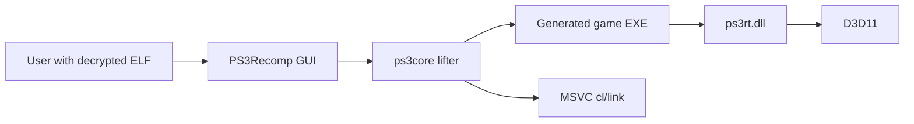
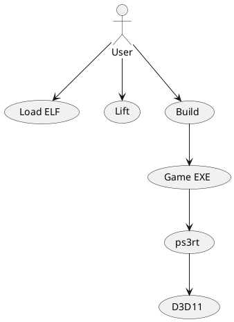
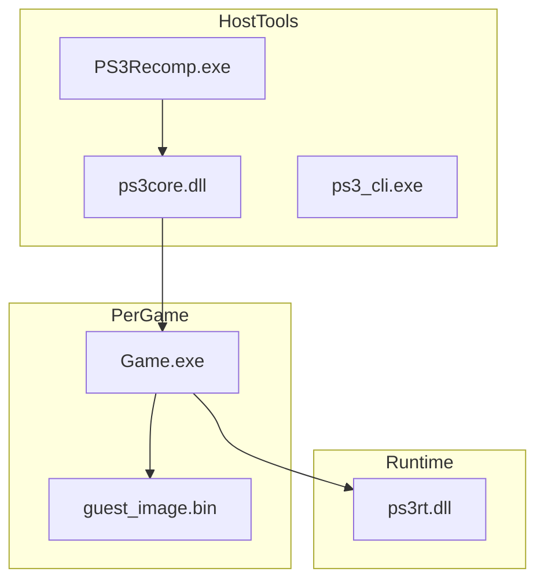
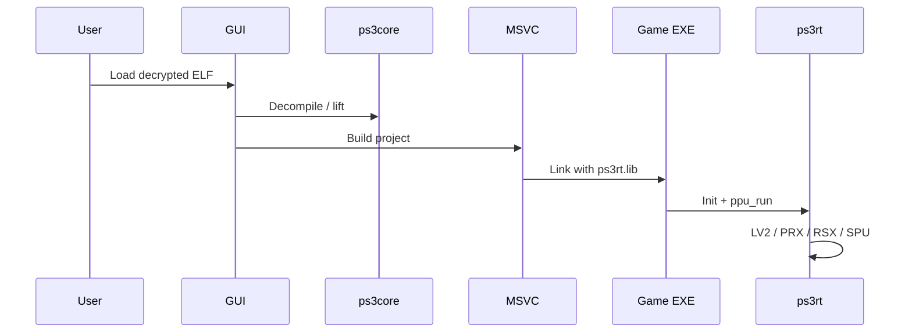
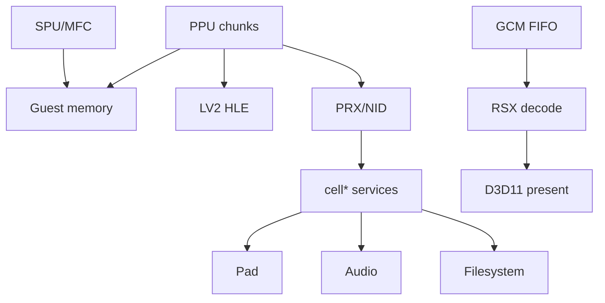
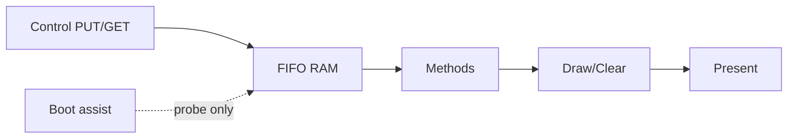
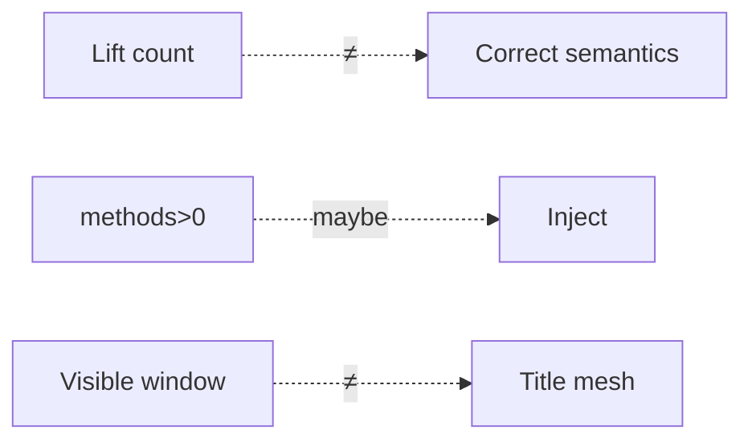
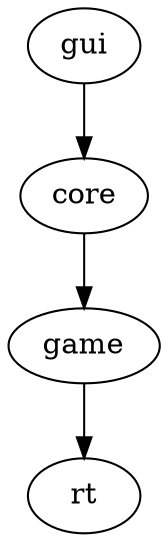

# PPSX33 Architecture

**Project site:** [https://ppsx33.xo.je/](https://ppsx33.xo.je/)  
**Repository:** [NotY215/PPSX33](https://github.com/NotY215/PPSX33)  
**Diagram index:** [DIAGRAMS.md](DIAGRAMS.md)

Intended architecture for the static recompiler and host runtime. Diagram sources use Mermaid, PlantUML, D2, Graphviz, seqdiag, blockdiag, Nomnoml, WaveDrom, Markmap, Svgbob, Vega-Lite, and C4 (see DIAGRAMS.md). Status labels are engineering targets, not playability claims.

## 1. System context





## 2. Containers



```d2
gui: PS3Recomp.exe
core: ps3core.dll
rt: ps3rt.dll
game: Game EXE
gui -> core: lift/build
core -> game: emit
game -> rt: link/load
```

## 3. Pipeline



```seqdiag
seqdiag {
  GUI -> ps3core [label = "lift"];
  GUI -> MSVC [label = "build"];
  MSVC -> Game [label = "link"];
  Game -> ps3rt [label = "run"];
}
```

## 4. Runtime layers



```blockdiag
blockdiag {
  group guest { PPU; MEM; FIFO; SPU; }
  group hle { LV2; PRX; }
  group host { D3D11; Audio; Pad; }
  PPU -> LV2; PPU -> PRX; FIFO -> D3D11;
}
```

```nomnoml
[PPU] -> [LV2]
[PPU] -> [PRX]
[FIFO] -> [RSX]
[RSX] -> [D3D11]
```

## 5. RSX path



**Invariant:** assist draws prove host path only; title PUT + shaders required for real scenes.

## 6. Trust boundaries



```wavedrom
{ signal: [
  { name: "PC", wave: "x3.4.5.x", data: ["chunk","import","recover"] },
  { name: "PUT", wave: "0.1..1.0" },
  { name: "flip", wave: "0.1.0.1.0" }
]}
```

## 7. Build artifacts

| Artifact | Role |
| --- | --- |
| PS3Recomp.exe | GUI |
| ps3core.dll | ELF / lift / project |
| ps3rt.dll | Runtime HLE + RSX |
| ppsx33-logo.ico | App + UI + optional game icon |
| guest_image.bin | Guest memory |



```markmap
# PPSX33
## Tools
### GUI
### ps3core
## Runtime
### PPU
### RSX
### SPU
## Output
### Game EXE
```

```svgbob
 ELF --> Lifter --> EXE
                 |
                 v
               ps3rt
```

## 8. Related

- [https://ppsx33.xo.je/](https://ppsx33.xo.je/)
- [ROADMAP.md](../ROADMAP.md)
- [DIAGRAMS.md](DIAGRAMS.md)
- [ENGINEERING.md](../ENGINEERING.md)
- [README.md](../README.md)
