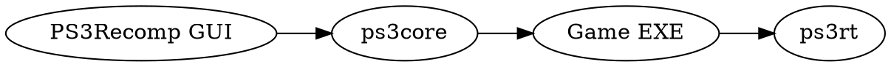

# PPSX33 diagram index

Project site: [https://ppsx33.xo.je/](https://ppsx33.xo.je/)

Primary diagrams live in [ARCHITECTURE.md](ARCHITECTURE.md). This index lists **supported text-diagram formats** used or accepted in PPSX33 docs so contributors can render them offline or via [Kroki](https://kroki.io/).

## Languages in use

| Language | Typical use in PPSX33 docs |
| --- | --- |
| **Mermaid** | Flowcharts, sequence, C4-style context/container (GitHub-native) |
| **PlantUML** | C4, activity, component |
| **D2** | Clean container topology |
| **Graphviz (DOT)** | Dependency graphs |
| **flowchart.js** | Simple browser flows |
| **js-sequence-diagrams** | Lightweight sequences |
| **Ditaa** | ASCII boxes → PNG |
| **WaveDrom** | Timing / handshake sketches |
| **Vega / Vega-Lite** | Metrics charts (lift coverage, frame stats) |
| **ZenUML** | Alternate sequence syntax |
| **Kroki** | Unified render backend for many of the above |
| **blockdiag / seqdiag / actdiag / nwdiag** | Python-diag family |
| **Nomnoml** | UML-ish structure |
| **Markmap** | Mind-map of roadmap phases |
| **Svgbob** | ASCII art → SVG |
| **C4-PlantUML** | Formal C4 model |

## Example Graphviz (module dependency sketch)



## Example Markmap (roadmap outline)

```markmap
# PPSX33
## Phase 0 Baseline
## Phase 1 PPU trust
## Phase 2 Runtime
## Phase 3 SPU
## Phase 4 RSX
## Phase 5 HLE measured
## Phase 6 Optimization
```

## Example Vega-Lite (placeholder metric)

```json
{
  "$schema": "https://vega.github.io/schema/vega-lite/v5.json",
  "description": "Illustrative only — replace with real lift metrics",
  "data": { "values": [
    {"area": "PPU lift", "pct": 70},
    {"area": "LV2 HLE", "pct": 40},
    {"area": "RSX title", "pct": 15},
    {"area": "SPU", "pct": 35}
  ]},
  "mark": "bar",
  "encoding": {
    "x": {"field": "area", "type": "nominal"},
    "y": {"field": "pct", "type": "quantitative"}
  }
}
```

## Example Svgbob

```svgbob
    +--------+     +---------+     +-------+
    |  ELF   |---->|  Lifter |---->|  EXE  |
    +--------+     +---------+     +---+---+
                                       |
                                       v
                                   +-------+
                                   | ps3rt |
                                   +-------+
```

## Rendering tips

1. Prefer **Mermaid** in GitHub-visible markdown for zero-tool browsing.
2. Keep PlantUML/D2/DOT sources in the same markdown fenced blocks for Kroki/CI.
3. Do not paste large binary SVG dumps; keep diagram **source** in-repo.
4. When a diagram claims a feature is “done”, cross-check [ROADMAP.md](../ROADMAP.md) status tables.
